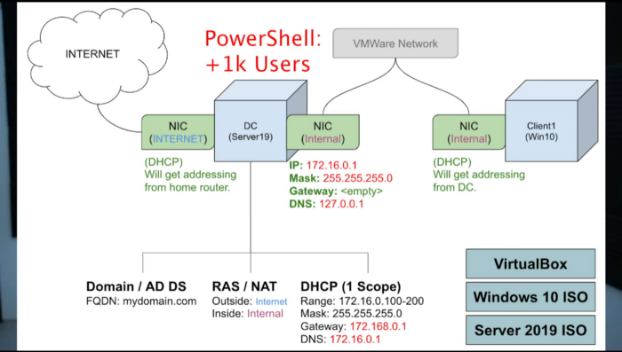
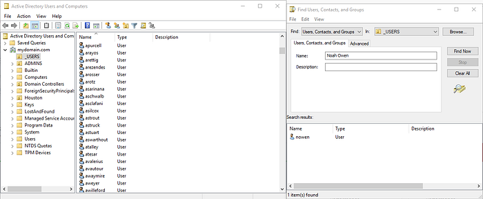

# Active Directory Home Lab

A VirtualBox lab exploring Windows domain administration, DHCP/DNS, client domain joins, and bulk user provisioning with PowerShell.

**By Noah Owen · Lab completed: September 12, 2022**

[Lab walkthrough](docs/lab-walkthrough.md) · [Screenshots](#screenshots) · [Attribution](#attribution)

## Project status

This repository documents a completed learning lab from 2022. The walkthrough and screenshots describe the environment at that time. It has not been rebuilt or retested since; the screenshots do not establish that it is currently deployed.

## Technologies

Windows Server 2019 · Windows 10 · Oracle VirtualBox · Active Directory Domain Services · DHCP · DNS · RAS/NAT · PowerShell

## Lab workflow

1. Create a Windows Server VM with internet-facing and internal VirtualBox network adapters.
2. Install Active Directory and promote the server to a domain controller.
3. Configure RAS/NAT, DHCP, and a domain administrator account.
4. Populate the domain with over 1,000 users using the credited PowerShell script.
5. Create a Windows 10 client, join the domain, and sign in with a domain account.

## Documented results

- Domain controller and client VMs running in VirtualBox.
- DHCP and DNS configuration shown in the original screenshots.
- A populated directory and a domain-joined Windows client.
- PowerShell bulk user creation demonstrated in the original environment.

## Screenshots

### Lab network overview

Domain controller and Windows client topology used for the lab.

### Active Directory users

The populated directory and a search for my lab account.

[See the full walkthrough and screenshot sequence →](docs/lab-walkthrough.md)

## Repository contents

| Path | Contents |
| --- | --- |
| [docs/lab-walkthrough.md](docs/lab-walkthrough.md) | Lab walkthrough, figures, and captions |
| [images/](images/) | Locally stored lab figures |
| [docs/image-index.json](docs/image-index.json) | Local figure filenames and captions |

This repository does not include VM images, executable scripts, exported queries, deployment templates, or live credentials. Screenshots of code are historical evidence, not executable source files.

## Attribution

The bulk user creation script used in the lab is [Josh Madakor’s AD_PS](https://github.com/joshmadakor1/AD_PS). It is linked for attribution and has not been copied into this repository.

This lab is documented by [Noah Owen](https://github.com/Nowen99). Referenced third-party material retains its original ownership; this repository does not claim authorship of those resources or grant a new license for them.
