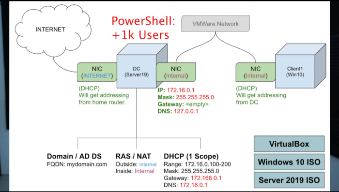
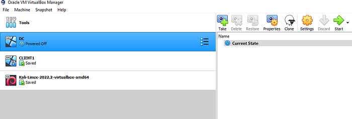
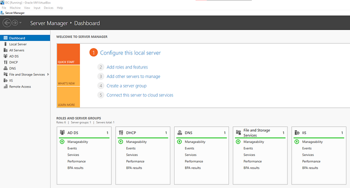
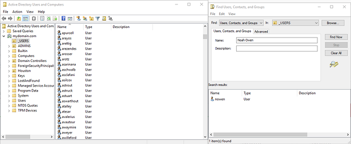
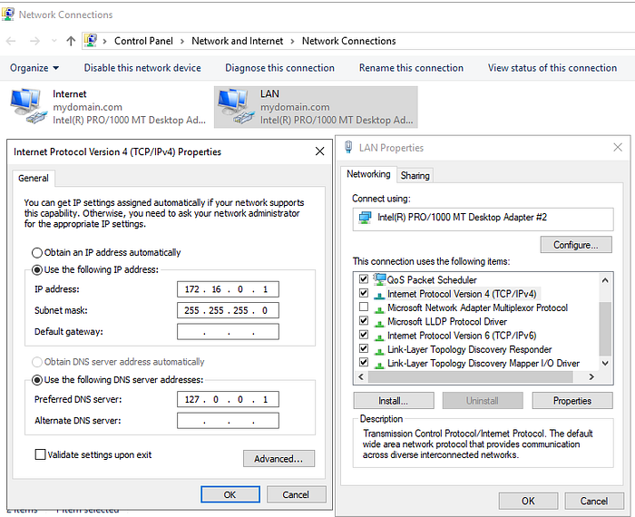
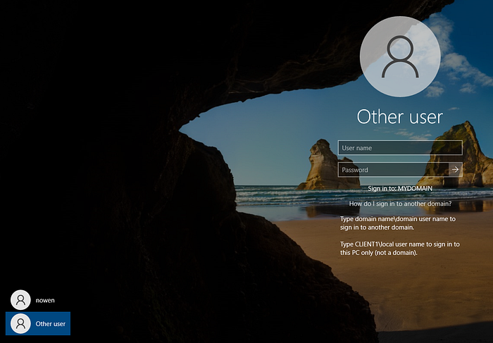
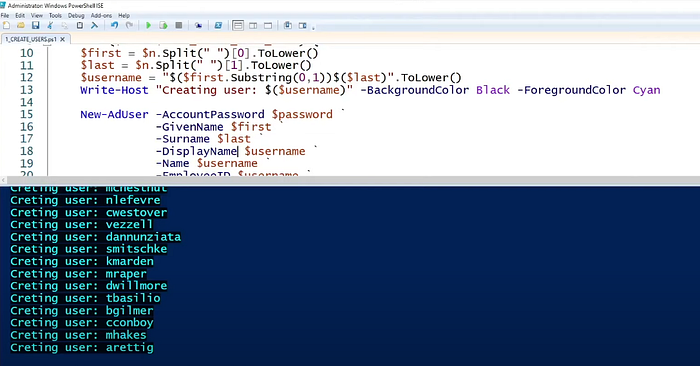

> By Noah Owen · Lab completed: September 12, 2022
> Screenshots and steps document the 2022 lab environment.

# How I Setup a Home Lab Running Active Directory With Oracle VirtualBox and Added Users with PowerShell

In this lab, I’ll guide you through my process of building an Active Directory home lab environment with Oracle VirtualBox. This hands-on experience helped me gain a deeper understanding of Active Directory and its workings. The following visual provides an overview of the lab setup

*Lab architecture overview*

I started the lab by downloading Oracle VirtualBox and two Windows ISO files, Windows 10 and Server 2019. I then created a virtual machine and assigned two network adapters, one for internet access and the other for the internal VirtualBox network. I installed Active Directory on the virtual machine and promoted it to a domain controller, set up RAS/NAT to allow clients access to the internet, created a domain admin account, and enabled DHCP on the domain controller. I obtained a PowerShell script to populate the domain with over a thousand users. I then created another virtual machine, installed Windows 10, connected it to the private VirtualBox network, joined it to the domain, and logged in with a domain account. Attached are images from my lab environment.

*Domain Controller VM Running Server 2019 and Client VM Running Windows 10*

*Functional DHCP and DNS Services*

*Populated Active Directory Domain with my own Account Navigating AD by Searching for Myself*

*Manual IP Address Assignment for the Internal Network, the Other Adapter Using DHCP*

*Client VM Running Windows 10 Connected to my Domain.*

*PowerShell Script Adding Users*

[https://github.com/joshmadakor1/AD_PS](https://github.com/joshmadakor1/AD_PS) — PowerShell script used to populate the domain

## CONCLUSION

The lab experience was extremely beneficial in expanding my understanding of Active Directory and its operations in a domain environment. Active Directory is a crucial component in modern organizations as it allows employees to access the resources they need from any computer connected to the domain. In addition, the feature of authentication and authorization of users through group policy is crucial for maintaining the security of an organization’s network.

Having hands-on experience with setting up and configuring an Active Directory environment helped me appreciate the significance of this technology and how it operates. Understanding the key functions of Active Directory is important for anyone involved in network administration or IT management. This lab not only allowed me to enhance my technical skills but also gave me a better understanding of how to navigate and utilize Active Directory effectively in a real-world setting. Overall, the lab was a valuable learning experience that I would highly recommend to anyone looking to improve their understanding of this technology.
